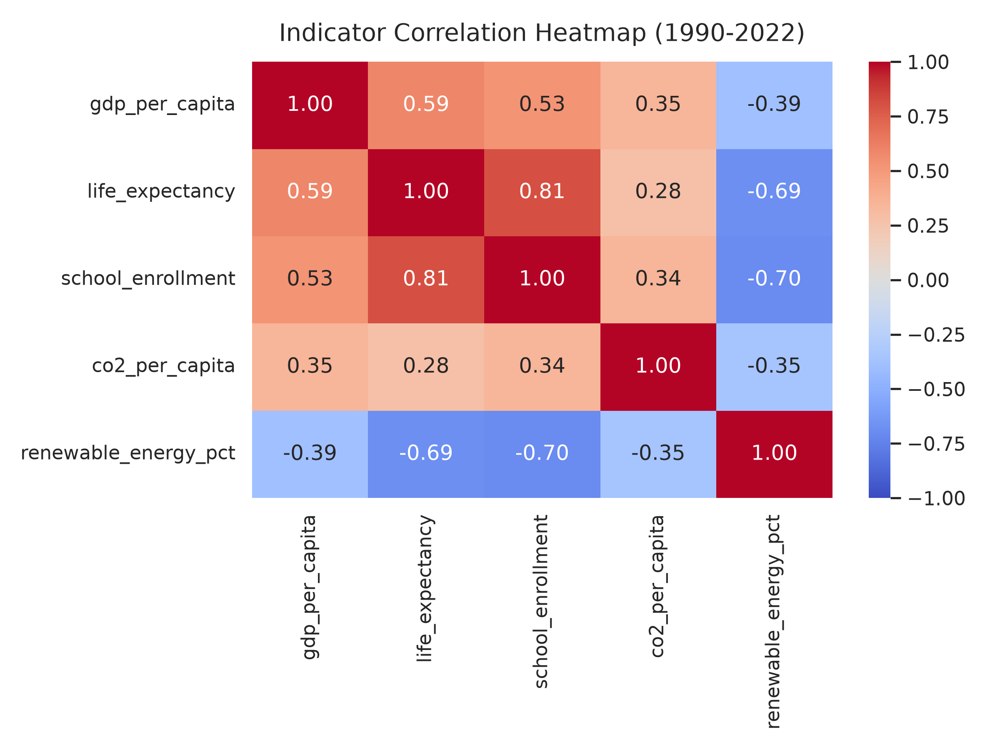
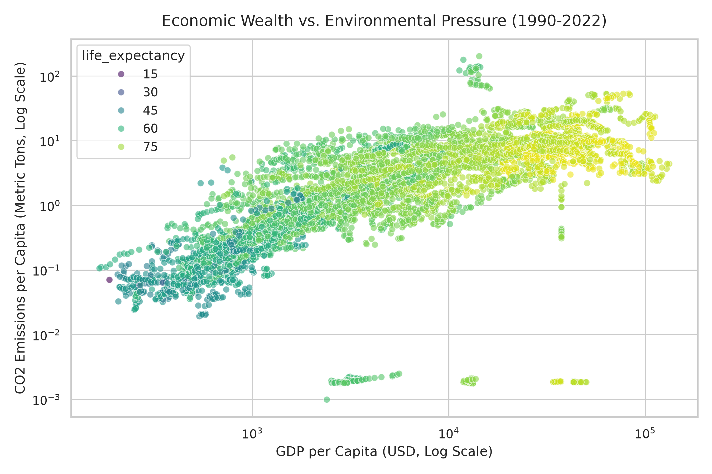
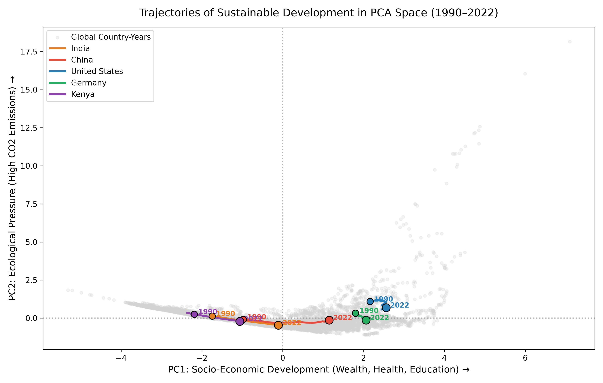
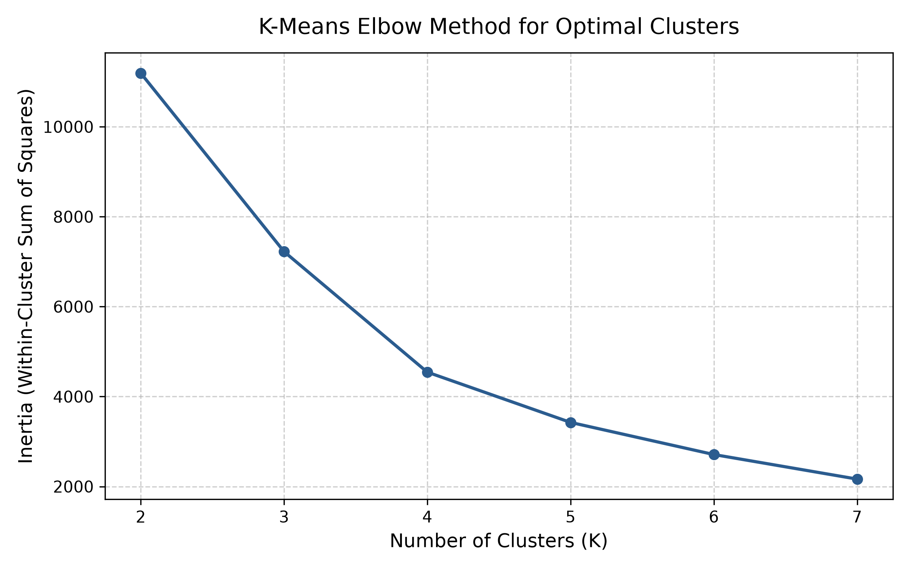
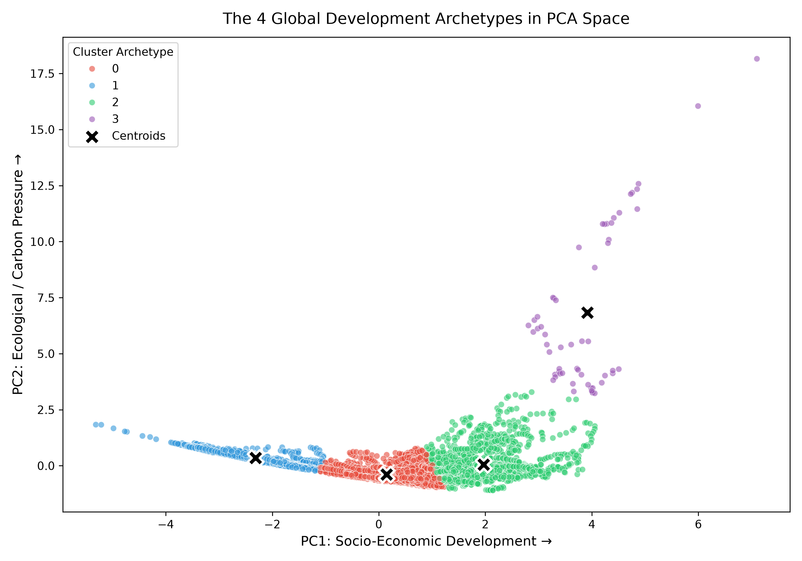

# Global Trajectories of Sustainable Development (1990–2022)
### An Empirical Investigation into Economic Growth, Human Flourishing, and Environmental Decoupling

[](https://www.python.org/)
[](https://opensource.org/licenses/MIT)
[](http://localhost:8501)
[](https://databank.worldbank.org/source/world-development-indicators)

---

## 1. Project Aim & Core Research Question

A central question in modern economics and climate policy is whether human prosperity is inherently bound to environmental destruction:

> **"Can countries achieve sustained economic growth and improved human wellbeing while reducing environmental pressure over time, and do distinct structural pathways to sustainable development exist?"**

This project was built for the course **Data Extraction Processes (DEP)**. Rather than relying on static, pre-cleaned Kaggle datasets, this project implements a complete, reproducible **Extract-Transform-Load (ETL) and Unsupervised Machine Learning pipeline** starting from raw World Bank API queries, conducting longitudinal cleaning and interpolation, and applying **Principal Component Analysis (PCA)** and **K-Means Clustering** across **193 sovereign nations over 33 years (1990–2022)**.

---

## 2. Theoretical Framework & Hypotheses

Our empirical inquiry is grounded in two primary economic frameworks:

1. **The Environmental Kuznets Curve (EKC) Hypothesis:** Postulates an inverted U-shaped relationship between economic growth and environmental degradation—pollution initially rises as an agrarian economy industrializes, then peaks and falls as it matures into an advanced, clean-tech service economy.
2. **Decoupling Theory:**
   - **Relative Decoupling:** Economic output grows faster than resource consumption or emissions.
   - **Absolute Decoupling:** Economic output expands while resource consumption and emissions strictly decline in absolute terms.
3. **The Traditional Biomass Trap Hypothesis:** In developing countries, high reported "renewable energy" shares often do not indicate modern clean grids, but rather the burning of traditional firewood, dung, and charcoal for subsistence survival.

---

## 3. Data Taxonomy: Selected Indicators

To capture the tri-pillar nature of sustainable development without collinear redundancy, five core indicators were extracted from the World Bank World Development Indicators (WDI):

| Pillar | Indicator Name | World Bank Series Code | Metric Unit |
| :--- | :--- | :--- | :--- |
| **Economic** | GDP per capita | `NY.GDP.PCAP.KD` | Constant 2015 US$ |
| **Human Wellbeing** | Life expectancy at birth | `SP.DYN.LE00.IN` | Total Years |
| **Human Wellbeing** | Secondary School Enrollment | `SE.SEC.ENRR` | % Gross Enrollment |
| **Environmental** | $\text{CO}_2$ emissions per capita | `EN.GHG.CO2.PC.CE.AR5` | Metric Tons $\text{CO}_2\text{e}$ / capita |
| **Environmental** | Renewable energy consumption | `EG.FEC.RNEW.ZS` | % of Total Final Energy |

---

## 4. End-to-End Pipeline & Methodology

```text
[World Bank WDI API] ──(scripts/01_extract_data.py)──► Raw Multi-Indicator Data (8,778 rows)
                                                              │
                                                              ▼
[Data Preprocessing] ──(scripts/02_clean_data.py)────► Panel Imputation & Aggregate Removal (6,369 rows)
                                                              │
                                                              ▼
[EDA & Scaling]      ──(scripts/03_eda_and_scaling.py)► Correlation, Visualizations & Z-Score Scaling
                                                              │
                                                              ▼
[Unsupervised ML]    ──(scripts/04_pca_and_clustering.py)► PCA Trajectories (78% Var) & K-Means Archetypes
                                                              │
                                                              ▼
[Research Dashboard] ──(dashboard/app.py)────────────► Interactive Streamlit Decision System
```

---

### Phase 1: Raw Data Acquisition (`scripts/01_extract_data.py`)
- **API Extraction:** Rather than using static files, data was extracted programmatically via the World Bank API using `wbgapi` across all 266 world entities and 33 years ($1990\text{–}2022$).
- **Data Engineering Resilience:** Initial combined queries suffered connection drops (Cloudflare timeout at page 34). The extraction pipeline was refactored into a sequential, rate-limited extractor querying each indicator independently and merging into a unified longitudinal schema:
> **Raw Dataset Output:** 8,778 rows × 8 columns → `data/raw/wdi_raw_data.csv`

---

### Phase 2: Data Cleaning & Panel Imputation (`scripts/02_clean_data.py`)
Real-world international data is profoundly messy:
1. **Filtering Regional Aggregates:** The World Bank combines sovereign nations with regional groupings (`World`, `Arab World`, `High income`). Using `wb.economy.DataFrame(aggregate=False)`, **49 regional aggregates (1,617 rows) were purged**, preserving only 217 sovereign nations.
2. **Missingness Diagnostic:**
   - `life_expectancy`: 0.00% missing
   - `gdp_per_capita`, `co2_per_capita`, `renewable_energy_pct`: ~5.8%–6.5% missing
   - `school_enrollment`: **42.20% missing** (developing countries only conduct school censuses sporadically).
3. **Thresholding Hopeless Microstates:** Territories and microstates with >30% total missingness (e.g., St. Martin, Monaco, Channel Islands, South Sudan) were pruned (16 entities dropped).
4. **Time-Series Linear Interpolation per Country:** For nations with solid historical reporting, within-country year gaps were interpolated linearly:
   $$x_{t} = x_{t-1} + \frac{x_{t+1} - x_{t-1}}{2}$$
   Followed by forward-fill (`ffill`) and backward-fill (`bfill`) for historical boundary years.
5. **Final Result:** A balanced, pristine panel dataset with **zero missing values**:
   > **Panel Dataset Dimensions:** 193 Sovereign Nations × 33 Years = **6,369 balanced rows** → `data/processed/wdi_clean_data.csv`

---

### Phase 3: Exploratory Data Analysis & Feature Scaling (`scripts/03_eda_and_scaling.py`)

#### 1. Correlation Matrix & The Biomass Effect
Exploratory correlation revealed an essential empirical finding:
- `school_enrollment` ↔ `life_expectancy`: **+0.81** (Education and longevity advance together).
- `renewable_energy_pct` ↔ `life_expectancy`: **-0.69** *(Strong Negative)*
- `renewable_energy_pct` ↔ `school_enrollment`: **-0.70** *(Strong Negative)*



> **Why are renewables negatively correlated with human wellbeing?** In subsistence economies, "renewable energy" predominantly consists of unimproved biomass (firewood, charcoal, crop residue) burned inside homes due to lack of electricity grids. Industrializing nations transition *away* from firewood to grid power, temporarily lowering their renewable share before modern clean tech emerges.



#### 2. Feature Standardization (Z-Score Normalization)
Because GDP per capita spans [$166, $132,595] while CO₂ per capita spans [0, 202], distance-based models would be overwhelmed by monetary variance without scaling:
$$z_i = \frac{x_i - \mu}{\sigma}, \quad \mu = \frac{1}{N}\sum_{i=1}^N x_i, \quad \sigma = \sqrt{\frac{1}{N}\sum_{i=1}^N (x_i - \mu)^2}$$

Every feature was transformed to $\mu = 0, \sigma = 1$ → `data/processed/wdi_scaled_data.csv`.

---

### Phase 4: Machine Learning — PCA & Trajectory Modeling (`scripts/04_pca_and_clustering.py`)

#### 1. Principal Component Analysis (PCA)
PCA compressed the 5 standardized indicators into 2 composite axes by solving the eigen-decomposition of the empirical covariance matrix $\mathbf{C}$:
$$\mathbf{C} = \frac{1}{N}\mathbf{X}^T\mathbf{X}, \quad \mathbf{C}\mathbf{v}_k = \lambda_k \mathbf{v}_k$$

- **PC1 (61.56% of Variance):** Socio-Economic Development (High loadings on life expectancy $+0.511$, education $+0.510$, and GDP $+0.411$).
- **PC2 (16.39% of Variance):** Carbon & Ecological Load (Dominant loading on $\text{CO}_2$ emissions per capita $+0.915$).
- **Total Variance Captured:** **$77.95\%$** in 2 dimensions.



#### 2. K-Means Clustering & The Elbow Method
To determine whether distinct development pathways exist, K-Means was trained for $K \in [2, 7]$ minimizing within-cluster inertia:
$$J = \sum_{k=1}^{K} \sum_{\mathbf{x}_i \in C_k} \|\mathbf{x}_i - \boldsymbol{\mu}_k\|^2$$



The mathematical elbow point occurred cleanly at **$K = 4$**, partitioning all 6,369 country-years into 4 structural archetypes:



---

## 5. The 4 Global Development Archetypes

| Cluster | Archetype Name | Mean GDP/cap | Mean Life Exp | Mean Schooling | Mean CO₂/cap | Mean Renewables | Key Representative Nations |
| :---: | :--- | :---: | :---: | :---: | :---: | :---: | :--- |
| **1** | **Developing & Biomass-Reliant** | $1,351 | 57.1 yrs | 32.9% | 0.50 t | 72.8% | Kenya, Uganda, Ethiopia, Nepal |
| **0** | **Emerging Transitioners** | $5,437 | 70.4 yrs | 81.0% | 2.96 t | 20.4% | India, Brazil, Indonesia, Vietnam |
| **2** | **Advanced Decoupled Economies** | $36,602 | 77.9 yrs | 104.2% | 10.12 t | 10.6% | Germany, Japan, France, UK, USA |
| **3** | **Hyper-Carbon Petrostates** | $35,192 | 71.6 yrs | 103.1% | **81.13 t** | 0.13% | Qatar, Kuwait, Bahrain, UAE |

---

## 6. Key Empirical Findings & Conclusions

1. **Distinct Pathways Exist:** The world does not follow a singular development trajectory. Empirical data confirms two diverging paths:
   - **Path A (The Decoupling Transition):** Cluster 1 → Cluster 0 → Cluster 2. Countries progress from agrarian biomass reliance through middle-income urbanization into advanced decoupling, where living standards rise while carbon intensity peaks and declines.
   - **Path B (The Resource Curse / Carbon Lock-In):** Diverges into Cluster 3, where nations achieve high income purely through fossil extraction without developing clean energy infrastructure (0.13% renewable share).
2. **Empirical Decoupling is Real:**
   - **Germany:** Trajectory curves downward and rightward in PCA space between 1990 and 2022—GDP per capita expanded while emissions dropped significantly (**Absolute Decoupling**).
   - **India:** Made a massive horizontal leap along PC1 from $-1.7$ to $-0.1$ while keeping per-capita emissions below $2\text{ tons}$ (**Relative Decoupling**).
3. **The Clean Energy Leapfrogging Imperative:** Developing nations in Cluster 1 should not replicate China's coal-heavy intermediate phase; policy support must finance direct leapfrogging from traditional biomass to decentralized solar and wind grids.

---

## 7. Interactive Research Dashboard

The project includes an interactive, dark-mode research dashboard built with **Streamlit** and **Plotly**:

```bash
# Launch the dashboard locally
streamlit run dashboard/app.py
```

### Dashboard Capabilities:
- **Trajectory Explorer:** Select any combination of 193 nations to trace their historical path across the PCA plane with animated year markers.
- **Archetype Profiler:** Inspect 2022 global distribution breakdowns and cluster averages.
- **Longitudinal Dual-Axis Time Series:** Interactive GDP vs. $\text{CO}_2$ time series with an automated **Decoupling Diagnosis Engine**.
- **Mathematical Foundations:** Complete LaTeX formulations for Standard Scaler, PCA, and Lloyd's optimization.

---

## 8. Repository Structure

```text
DEP_research/
├── .streamlit/
│   └── config.toml               # Streamlit theme configuration (Obsidian Dark)
├── data/
│   ├── raw/
│   │   └── wdi_raw_data.csv       # Untouched raw API extraction (8,778 rows)
│   └── processed/
│       ├── wdi_clean_data.csv     # Cleaned, interpolated panel data (6,369 rows)
│       ├── wdi_scaled_data.csv    # Z-score standardized features
│       └── wdi_clustered_data.csv # Final dataset with PC1, PC2 & Cluster labels
├── figures/
│   ├── 01_correlation_heatmap.png # Indicator correlation matrix
│   ├── 02_gdp_vs_co2_scatter.png  # Wealth vs emissions scatter plot
│   ├── 03_kmeans_elbow.png        # K-Means Inertia Elbow optimization curve
│   ├── 04_pca_trajectories.png    # 33-Year historical country trajectories in PCA
│   └── 05_kmeans_clusters.png     # The 4 global development archetypes
├── scripts/
│   ├── 01_extract_data.py         # World Bank API data ingestion pipeline
│   ├── 02_clean_data.py           # Aggregate removal & time-series interpolation
│   ├── 03_eda_and_scaling.py      # Statistical diagnostics & StandardScaler
│   └── 04_pca_and_clustering.py   # PCA decomposition & K-Means clustering
├── dashboard/
│   └── app.py                     # Interactive Streamlit analytics dashboard
├── requirements.txt               # Project Python dependencies
├── .gitignore                     # Git ignore rules
└── README.md                      # Complete project documentation
```

---

## 9. How to Reproduce

### 1. Clone Repository & Setup Virtual Environment
```bash
git clone https://github.com/whoisadi19/country_trajectories_research.git
cd country_trajectories_research

python3 -m venv venv
source venv/bin/activate
pip install -r requirements.txt
```

### 2. Execute Data Pipeline Sequentially
```bash
# Step 1: Extract raw data from World Bank API
python scripts/01_extract_data.py

# Step 2: Clean, filter aggregates, and interpolate panel data
python scripts/02_clean_data.py

# Step 3: Run EDA, generate correlation plots, and scale features
python scripts/03_eda_and_scaling.py

# Step 4: Fit PCA, compute Elbow curve, and train K-Means model
python scripts/04_pca_and_clustering.py

# Step 5: Launch the interactive research dashboard
streamlit run dashboard/app.py
```

---

## Author & Course Information
- **Student Researcher:** Adi ([@whoisadi19](https://github.com/whoisadi19))
- **Course:** Data Extraction Processes (DEP)
- **Data Source:** World Bank World Development Indicators (WDI) API
